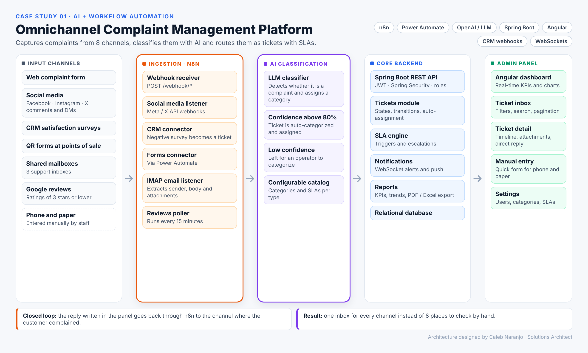
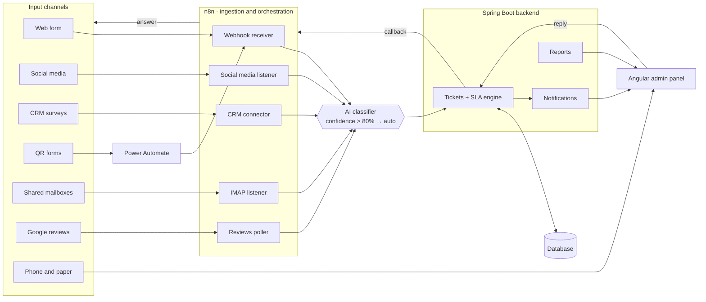

# Omnichannel Complaint Management Platform

**AI + workflow automation case study.** Captures customer complaints from 8 channels with n8n, classifies them with AI and routes them as tickets with SLAs.

> [!IMPORTANT]
> **Confidential client project.** I designed this architecture for a real client. The source code, data and client identity are covered by confidentiality, so this repository holds only the architecture, design decisions and documentation. Names and details that could identify the client have been changed or left out.

## The problem

A multi-location consumer brand was receiving complaints in 8 different places: a web form, Facebook, Instagram and X, CRM satisfaction surveys, QR forms at points of sale, three shared mailboxes, Google reviews, phone calls and paper forms. Nobody had the full picture, responses were slow and there were no metrics.

## The solution

One platform that brings every channel into a single ticket inbox:

- **Ingestion with n8n.** Webhooks, an IMAP email listener, a social media listener and a reviews poller (every 15 minutes, ratings of 3 stars or lower) capture each channel automatically. **Power Automate** connects the Microsoft Forms used at points of sale.
- **AI classification.** An LLM step decides whether each message is a complaint and assigns a category. When confidence is above 80%, the ticket is categorized and assigned automatically. Otherwise an operator reviews it.
- **Ticket core.** A Spring Boot backend handles ticket states and transitions, automatic assignment, SLA triggers and escalations, roles with JWT, and real-time alerts over WebSockets.
- **Admin panel.** An Angular dashboard with live KPIs, a ticket inbox, ticket detail with timeline and attachments, a quick form for phone and paper complaints, and reports with PDF and Excel export.
- **Closed loop.** The reply written in the panel goes back through n8n to the channel where the customer complained.

## Architecture

## Tech stack

| Area | Technology |
|---|---|
| Automation | n8n (webhooks, IMAP, polling), Power Automate |
| AI | LLM classification through an API connector |
| Backend | Java, Spring Boot, Spring Security, JWT, WebSockets |
| Frontend | Angular, Angular Material / PrimeNG, RxJS |
| Integrations | Meta / X APIs, CRM webhooks, Google Business reviews, Microsoft Forms |

## Key design decisions

- **n8n as the integration layer.** New channels are added as workflows, without touching the backend.
- **Confidence threshold for AI.** Automation is used only when the model is confident, which keeps humans in control of edge cases.
- **One ticket model for every channel.** Reports and SLAs work the same no matter where a complaint came from.

## My role

Solutions architect: process analysis, architecture design, integration design and technical documentation.

---

**Caleb Naranjo** · Full-Stack Engineer & Solutions Architect · AI automation with n8n and Power Automate
